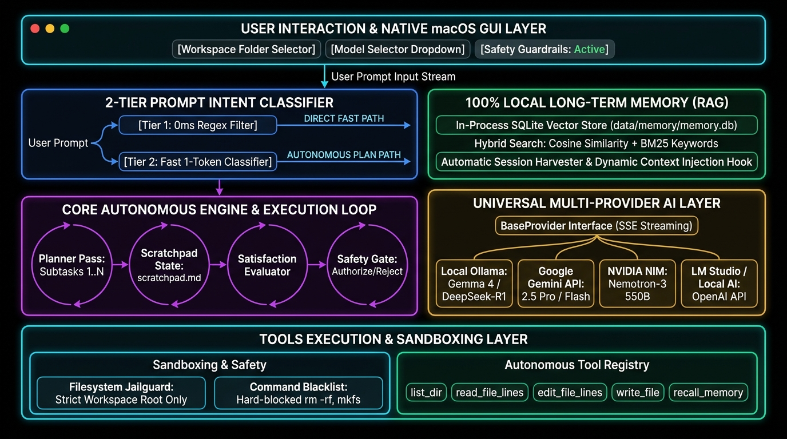

# Local Agent Desktop App

A powerful local autonomous coding agent equipped with a modern macOS desktop interface styled like Google Antigravity and OpenAI Codex, a 2-tier prompt intent classifier, multi-provider AI support (Google Gemini, NVIDIA NIM, Ollama, LM Studio, OpenAI-compatible), and 100% local Long-Term Agent Memory RAG.



---

## Highlights

* **Native Desktop & Web GUI**:
  * **Native macOS Desktop App (`gui/app.py`)**: Standalone CustomTkinter desktop interface with dark obsidian palette, rounded cards, live task plan checklists, and zero browser dependency.
  * **Web Interface (`server/api.py`)**: Optional browser/app-mode UI (`--web`) powered by Flask and Server-Sent Events (SSE) with translucent frosted glass and collapsible thinking token traces.
* **2-Tier Prompt Intent Classifier (`core/classifier.py`)**: Automatically distinguishes between direct conversational/Q&A requests (`DIRECT`, using a 0ms regex fast-path + lightweight LLM fallback) and complex engineering tasks that require multi-step autonomous planning (`PLAN`).
* **Multi-Provider AI Sources**:
  * **Google Gemini API**: Native function calling, streaming, and models (`gemini-2.5-flash`, `gemini-2.5-pro`, `gemini-2.5-flash-lite`).
  * **NVIDIA NIM**: Free tier cloud models with automated rate pacing and exponential backoff.
  * **Local / Remote Ollama**: Gemma 4, DeepSeek-R1, Llama 3, and local models via `http://localhost:11434`.
  * **LM Studio & Local AI**: Universal OpenAI-compatible endpoint support (`http://localhost:1234/v1`, vLLM, Jan, LocalAI, OpenRouter, Groq).
* **AI Source Setup Screen**: Dedicated GUI settings modal to configure API keys, endpoints, execution modes, and test connections with real-time feedback.
* **Long-Term Agent Memory RAG**: In-process local SQLite vector & hybrid keyword store that remembers past project decisions, bug fixes, and architectural notes across sessions with auto-injection and on-demand recall.
* **Human-in-the-Loop Safety Controls**:
  * **Safe Mode**: Reads auto-run; shell commands and file mutations display an interactive **[Authorize]** / **[Reject]** prompt.
  * **Auto Mode**: Autonomous execution for trusted workflows.
  * **Strict Mode**: Requires approval for every tool execution.
  * **Interrupt Button**: Instantly pause the agent and submit a redirection prompt.

---

## Quick Start

### 1. Launch the Native Desktop Application

Run the launcher from your terminal:
```bash
./run_app.py
```
Or with Python:
```bash
python3 run_app.py
```
This opens the standalone native macOS desktop window.

To launch the browser-based Web UI at `http://127.0.0.1:5000` instead:
```bash
python3 run_app.py --web
```

### 2. Configure Your AI Sources

Click the **Settings (⚙)** button in the top right to configure:
* **Google Gemini**: Paste your Gemini API key and click **Test Connection**.
* **NVIDIA NIM**: Paste your NVIDIA Developer API key.
* **Ollama**: Default `http://127.0.0.1:11434`.
* **LM Studio**: Default `http://localhost:1234/v1`.

### 3. CLI Mode (Optional)

If you wish to run in the terminal only:
```bash
python3 agent.py
```

---

## Architecture Overview

```
local-agent/
├── run_app.py                 ← Desktop & Web app launcher (--web for web mode)
├── agent.py                   ← Classic CLI agent
├── config.yaml.example        ← Example configuration settings
├── architecture_diagram.jpg   ← High-resolution system architecture diagram
├── gui/
│   └── app.py                 ← Standalone native macOS desktop GUI (CustomTkinter)
├── core/
│   ├── engine.py              ← Decoupled streaming agent execution loop
│   ├── classifier.py          ← 2-tier prompt intent classifier (DIRECT vs PLAN)
│   ├── planner.py             ← Autonomous task planner pass
│   ├── evaluator.py           ← Satisfaction evaluator
│   ├── scratchpad.py          ← Persistent scratchpad manager
│   ├── tools_schema.py        ← Function schemas for all tools
│   ├── memory/
│   │   ├── store.py           ← SQLite vector & hybrid semantic memory
│   │   ├── indexer.py         ← Session memory harvester
│   │   └── hook.py            ← Context injection hook
│   └── providers/
│       ├── base.py            ← Abstract BaseProvider interface
│       ├── gemini_provider.py
│       ├── nvidia_provider.py
│       ├── ollama_provider.py
│       └── openai_compatible_provider.py
├── server/
│   ├── api.py                 ← Flask REST API & Server-Sent Events (SSE) server
│   └── static/
│       ├── index.html         ← macOS Antigravity/Codex web UI
│       ├── style.css          ← Design tokens, curves, glassmorphism
│       └── app.js             ← Streaming client & state management
├── tools/                     ← Filesystem, shell, editing, notify, memory tools
├── prompts/                   ← System prompt templates
├── tests/                     ← Unit test suite (15 passing tests)
└── output/                    ← Target directory for created files
```

---

## Running Automated Tests

Run the unit test suite (15 tests covering classifier, engine, memory RAG, providers, and server):
```bash
./venv/bin/python -m unittest discover tests -v
```
