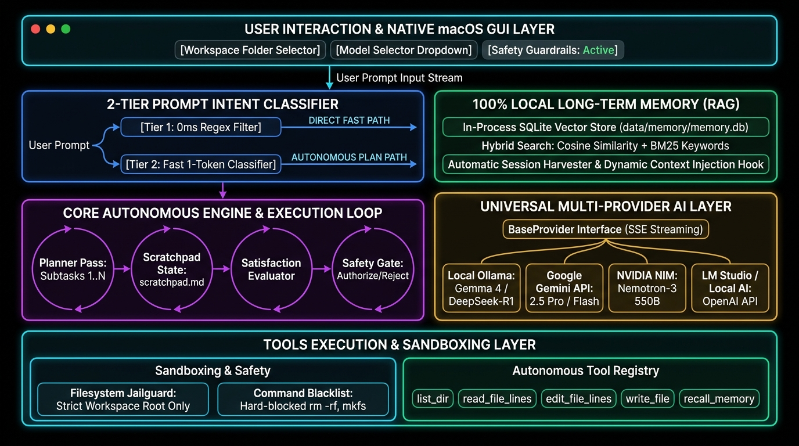

# Local Agent

A privacy-preserving autonomous coding and workspace assistant equipped with a native macOS CustomTkinter desktop app, an optional Flask SSE Web UI, a terminal CLI, a 3-agent collaborative orchestration loop (`PlannerAgent`, `ExecutorAgent`, `CriticAgent`), hybrid BM25 + vector Long-Term Memory RAG, and multi-provider AI support (Ollama, Google Gemini, NVIDIA NIM, LM Studio / OpenAI-compatible).



---

## Highlights

* **Multi-Agent Collaborative Architecture (`core/agents/`)**:
  * **`PlannerAgent` (`core/agents/planner_agent.py`)**: Uses read-only discovery tools and `ask_user` to detect ambiguities, builds a dependency-linked subtask DAG (`depends_on`), and dynamically replans when tasks fail or user requirements change.
  * **`ExecutorAgent` (`core/agents/executor_agent.py`)**: Runs scoped tool-calling loops (`TOOLS_SCHEMA`), records verified tool evidence into `output/scratchpad.md`, and submits structured `ExecutionReport`s.
  * **`CriticAgent` (`core/agents/critic_agent.py`)**: Independently inspects workspace artifacts with read-only tools and returns structured verdicts (`satisfied`, `next_action`, `needs_replan`) driving retries or dynamic replanning over `CollaborationBus` (`core/agents/bus.py`).
* **2-Tier Prompt Intent Classifier (`core/classifier.py`)**: Routes conversational/Q&A requests (`DIRECT`) in `<1 ms` via Tier-1 regex matching and reserves multi-agent decomposition (`PLAN`) for complex engineering tasks via regex + Tier-2 LLM classification.
* **Local Hybrid BM25 + Vector RAG (`core/memory/`)**: SQLite store (`data/memory/memory.db`) seeded with `knowledge/agent_kb.json`, combining Okapi BM25 ranking with Ollama `nomic-embed-text` embeddings (and a pure-Python hashed trigram vector fallback), injecting cited `[MEM-...]` context and harvesting session knowledge automatically.
* **Human-in-the-Loop (HITL) Governance**:
  * **Pre-Execution Plan Review**: Inspect, approve, revise with feedback, or cancel generated plans before execution in `Safe`/`Strict` modes.
  * **Tool Authorization Gate**: `Safe` (reads auto-run; writes/edits/shell require `[Authorize]`/`[Reject]` + optional feedback), `Auto`, and `Strict` modes.
  * **Interactive Clarification & Mid-Run Redirect**: `ask_user` pauses for user answers; **Interrupt** supports halting or supplying dynamic redirection instructions.
* **Multi-Provider AI Support**: Unified `BaseProvider` covering **Ollama**, **Google Gemini**, **NVIDIA NIM**, and **LM Studio / OpenAI-compatible** `/v1` endpoints.
* **Native Desktop, Web & CLI Interfaces**:
  * **Native Desktop GUI (`gui/app.py`)**: Standalone CustomTkinter window (`python3 run_app.py`).
  * **Web Interface (`server/api.py`)**: Flask REST + SSE UI at `http://127.0.0.1:5000` (`python3 run_app.py --web`).
  * **CLI (`agent.py`)**: Terminal mode (`python3 agent.py`).

---

## Installation & Setup

### 1. Clone & Install Dependencies
```bash
git clone https://github.com/Nikunj-Gupta-1/local-agent.git
cd local-agent
python3 -m venv venv
source venv/bin/activate
pip install -r requirements.txt
```

### 2. Configure Your Workspace & Provider
Copy the example config (never commit `config.yaml` or API keys):
```bash
cp config.yaml.example config.yaml
```
Edit `config.yaml` to set `workspace_roots`, `output_dir`, `log_dir`, and your model/API settings (or configure providers directly inside the GUI **Settings (⚙)** modal).

For local inference with Ollama:
```bash
ollama serve
ollama pull gemma4-e4b-64k:latest   # or any local tool-capable model
```

---

## Quick Start & Reproducing Demonstrations

* **Launch Native Desktop App (default):**
  ```bash
  ./venv/bin/python run_app.py
  ```
* **Launch Web UI (`http://127.0.0.1:5000`):**
  ```bash
  ./venv/bin/python run_app.py --web
  ```
* **Launch Terminal CLI:**
  ```bash
  ./venv/bin/python agent.py
  ```

### Suggested Demonstration Prompts
1. **Direct Fast-Path:** `"tell me how i can multiply 2 matrices"` → routes to `DIRECT` in `<1 ms` with zero planner overhead.
2. **Multi-Agent Planning & HITL:** `"build a python calculator module with tests"` in **Safe** mode → shows `PlannerAgent` DAG, Pre-Execution Plan Review gate, `ExecutorAgent` tool approval cards, `CriticAgent` verification verdicts, and inter-agent messages.
3. **Clarification (`ask_user`):** `"export a summary report from workspace data"` → agent pauses to confirm format/filename before writing.
4. **Local RAG Recall:** Open the **Memory** window to inspect seeded/harvested entries and ask `"what safety boundaries does Local Agent enforce?"` to observe `[MEM-...]` citation injection.

---

## Architecture Overview

```
local-agent/
├── run_app.py                 ← Desktop & Web app launcher (--web for web mode)
├── agent.py                   ← Classic CLI agent
├── requirements.txt           ← Python dependencies
├── config.yaml.example        ← Safe template configuration (no secrets)
├── architecture_diagram.jpg   ← High-resolution system architecture diagram
├── knowledge/
│   └── agent_kb.json          ← Curated seed RAG knowledge base
├── core/
│   ├── engine.py              ← Multi-agent event-streaming orchestrator
│   ├── classifier.py          ← 2-tier prompt intent classifier (DIRECT vs PLAN)
│   ├── planner.py             ← Planner facade delegating to PlannerAgent
│   ├── evaluator.py           ← Evaluator facade delegating to CriticAgent
│   ├── scratchpad.py          ← Persistent scratchpad & verified evidence state
│   ├── tools_schema.py        ← JSON schemas for 12 tools
│   ├── agents/
│   │   ├── bus.py             ← Inter-agent CollaborationBus & AgentMessage
│   │   ├── planner_agent.py   ← Discovery, DAG planning & dynamic replanning
│   │   ├── executor_agent.py  ← Tool-using execution specialist
│   │   └── critic_agent.py    ← Read-only verification & retry/replan critic
│   ├── memory/
│   │   ├── store.py           ← SQLite hybrid BM25 + vector store
│   │   ├── indexer.py         ← Session memory harvester
│   │   └── hook.py            ← Cited [MEM-...] context injection hook
│   └── providers/             ← BaseProvider, Ollama, Gemini, NVIDIA NIM, OpenAI
├── gui/app.py                 ← Standalone native macOS desktop GUI
├── server/                    ← Flask REST/SSE backend & web frontend
├── tools/                     ← Workspace-guarded file, edit, shell, notify, RAG tools
├── prompts/system.txt         ← Dynamic system prompt template
└── tests/                     ← Automated unit & integration tests
```

---

## Running Automated Tests

```bash
./venv/bin/python -m unittest discover tests -v
```
